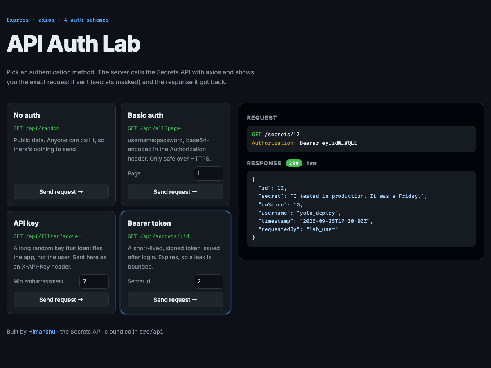

# 🧪 API Auth Lab

> A hands-on lab for the four common ways APIs authenticate: **none**, **HTTP Basic**, **API key** and **Bearer token**. It bundles its own Secrets API (the provider) and an Express + axios client (the consumer) that shows the exact request it sent, with secrets masked, next to the response.

**🔗 Live demo:** https://api-auth-lab.onrender.com/ *(free tier: the first visit after idle takes ~30–60s to wake up)*

[](https://github.com/himanshuuem/api-auth-lab/actions/workflows/test.yml)




## Why a bundled API?

The course's practice API was returning **502** when I built this, so the lab ships its own fully working Secrets API in `src/api/`. That also makes it a good place to see both sides of authentication, issuing credentials and checking them. Set `API_BASE_URL` to point the client at any compatible remote API instead.

## ✨ Features

### Provider (`src/api`)
| Endpoint | Auth | Notes |
|---|---|---|
| `POST /api/register` | none | Validates the username and password. Passwords are hashed with **scrypt** and a per-user salt. |
| `GET /api/generate-api-key` | none | Returns a random UUID key |
| `POST /api/get-auth-token` | password | Issues a **signed, expiring token** (HMAC-SHA256, JWT-shaped, no dependency) |
| `GET /api/random` | none | A random dev confession |
| `GET /api/all?page=` | **Basic** | Paginated, returns 404 past the last page |
| `GET /api/filter?score=` | **API key** | `X-API-Key` header or `?apiKey=` |
| `GET /api/secrets/:id` | **Bearer** | Echoes the token's subject as `requestedBy` |

All comparisons use `timingSafeEqual`, and errors are JSON with correct status codes (400, 401, 404, 409).

### Consumer (`src/client`)
- An **axios** instance with a base URL, timeout and `validateStatus` so 4xx responses are shown rather than thrown.
- **Bootstraps credentials** on first use (register, then API key, then token), lazily and with retry on failure.
- Shows the request line and headers **with secrets masked** (`Bearer eyJzdW…WQLE`), plus the status and timing.

## 🚀 Run Locally

```bash
git clone https://github.com/himanshuuem/api-auth-lab.git
cd api-auth-lab
npm install
npm run dev     # http://localhost:3000
npm test        # provider + end-to-end client tests
```

## 📁 Structure

```
api-auth-lab/
├── src/
│   ├── server.js
│   ├── app.js               # Mounts /api, renders the lab UI
│   ├── api/
│   │   ├── router.js        # Endpoints + auth guards
│   │   ├── auth.js          # scrypt passwords, API keys, signed tokens
│   │   └── secrets.js       # Sample data
│   └── client/lab.js        # axios consumer with masking
├── views/index.ejs
├── public/styles.css
└── test/api.test.js
```

## 📚 Origin

This builds on the **API authentication** lessons (Basic, API key, Bearer with axios) from [The Complete Web Development Bootcamp](https://www.udemy.com/course/the-complete-web-development-bootcamp/).

---

Made by [Himanshu](https://github.com/himanshuuem)
